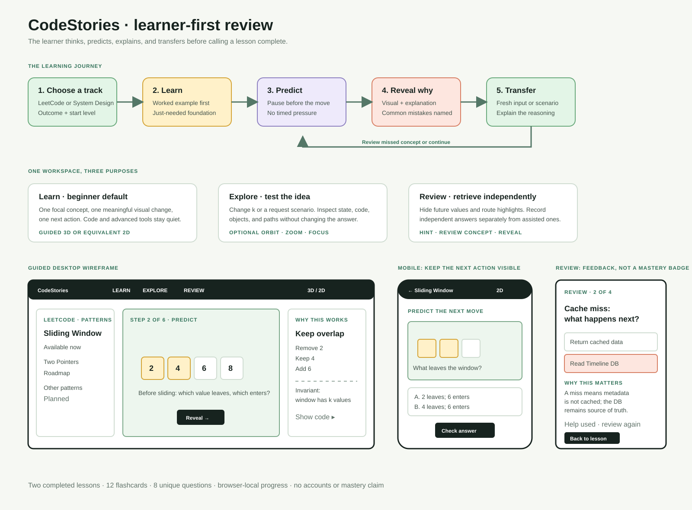

# CodeStories learner experience review

The original two-lesson milestone below is retained as historical context. The current app is one searchable page with all 75 algorithm stories and animations, classic 16-pattern organization plus Additional techniques, and independently optional quizzes and flashcards. System design remains the existing single lesson; the current interface is 2D-only. See README for current scope and source credits.

## Purpose

CodeStories will teach interview fundamentals through two complete explorable lessons:

1. **Maximum Average Subarray I** — a beginner-first fixed sliding-window lesson based on LeetCode problem 643.
2. **Image-feed read path** — a system-design walkthrough covering metadata cache hit, miss, unavailable cache, and CDN image delivery.

The goal is not to make learners operate a 3D viewer. After a lesson, learners should be able to solve a fresh small example and explain their decisions without following the animation.

## Review this journey

1. A learner chooses **LeetCode** or **System Design**, sees the starting knowledge and outcome, then starts learning or jumps to review.
2. **Learn** introduces one concept at a time: a concrete example, an in-context prerequisite, a prediction, the reveal, and an explanation.
3. **Explore** exposes the full scene, input/scenario controls, inspector, code, and optional camera controls. Guided 3D is the default; an equally complete 2D view is always available.
4. **Review** hides answer-bearing material until a learner submits, requests help, or reveals the answer. Feedback addresses the misconception and can return to the exact learning step.
5. Local browser state separates lesson completion, self-rated cards, independent answers, and help-assisted answers. It never claims mastery.

## What should be built

| Area | First milestone |
| --- | --- |
| Curriculum | A clearly labeled, original curated 16-pattern roadmap. Only one completed algorithm scene and one completed system-design walkthrough. |
| Algorithm lesson | Warm-up `[2, 4, 6, 8]`, `k = 2`; canonical `[1, 12, -5, -6, 50, 3]`, `k = 4`; and a hidden fresh review example. Explain values/indexes, contiguous ranges, sum/average, fixed windows, invariants, and complexity. |
| System lesson | Reader, gateway, feed service, metadata cache, Timeline DB, CDN, and object storage. Show explicit request and response paths. Keep metadata and image bytes distinct. |
| Interaction | Paused, deterministic step playback; prediction before reveal; reset, scrub, back/next, purposeful exploration, accessible object selection, and no camera requirement. |
| Recall | Six cards and four unique questions per lesson: identify, predict, explain, and transfer. Hints/reveals are labeled as assisted. |
| Rendering | Original procedural Three.js geometry, loaded from a pinned CDN only when needed. A usable 2D/DOM view is both a learner choice and an explicit fallback when 3D cannot load. |
| Persistence | A bounded, versioned `localStorage` record for valid input/scenario, paused position, mode/view preference, completion, cards, and latest answer/help state. |

## Learner review questions

| Perspective | Review question |
| --- | --- |
| Beginner | Can I state the goal, identify the next action, and understand each new word before code or controls appear? |
| Prediction | Does the page make me think before it shows the next sum or route? |
| Misconception | If I select a plausible wrong answer, does feedback explain the error and let me return without losing my place? |
| Transfer | Can I solve a changed input or route without seeing the answer first? |
| Returning learner | Can I resume, review missed concepts, and distinguish completion from an independent correct answer? |
| Accessibility | Can I complete the same lesson in 2D, with keyboard controls, without relying on color or camera movement? |

## Boundaries

This milestone does not implement all LeetCode 75 problems, reproduce a paid Grokking course, use downloaded biology/reference assets, provide accounts/backends/analytics, simulate real traffic, or claim measured learning effectiveness. The Anatomy-inspired viewer model and X references inform interaction direction only; all CodeStories content, art, and code are original.

## Review artifacts

- `plan.excalidraw` is the editable learner-journey and wireframe drawing.
- `plan.svg` is its portable preview.

## Implementation progress

The initial implementation now includes the two-track workspace, deterministic traces for both lessons, a 16-pattern roadmap, Learn/Explore/Review mode controls, a 2D diagram, an optional procedural Three.js view, custom algorithm and scenario inputs, six cards and four questions per lesson, browser-local state helpers, and automated logic/browser coverage.

The deeper hardening work remains tracked in the project plan: complete 3D camera and picking controls, full persisted assessment history/reset UI, expanded browser coverage for all scenarios and fallbacks, and the final accessibility/lifecycle acceptance pass.
